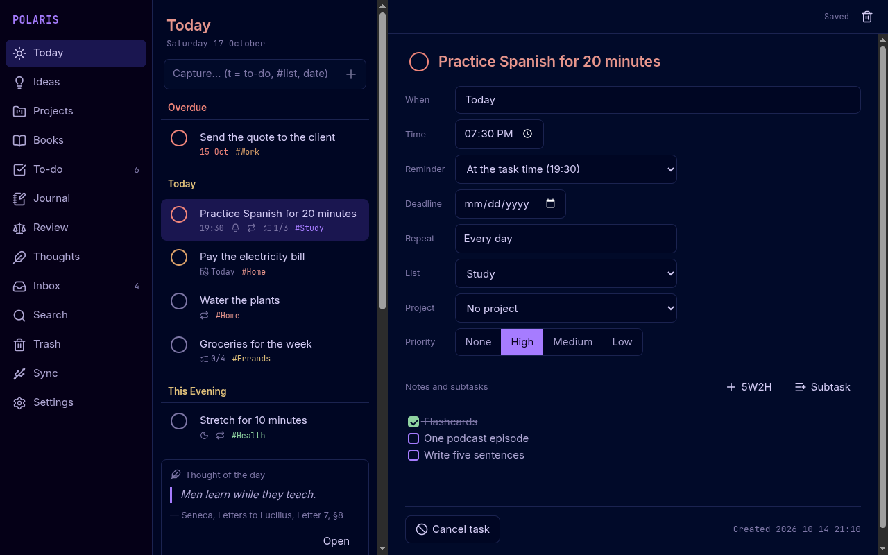
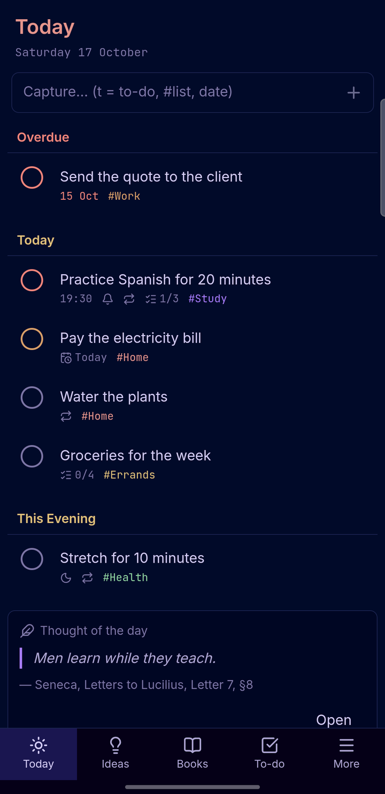
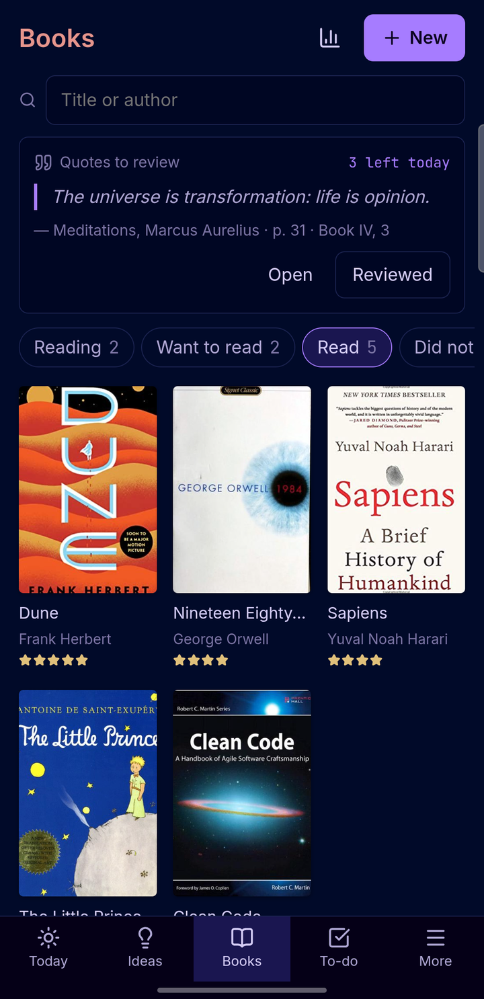
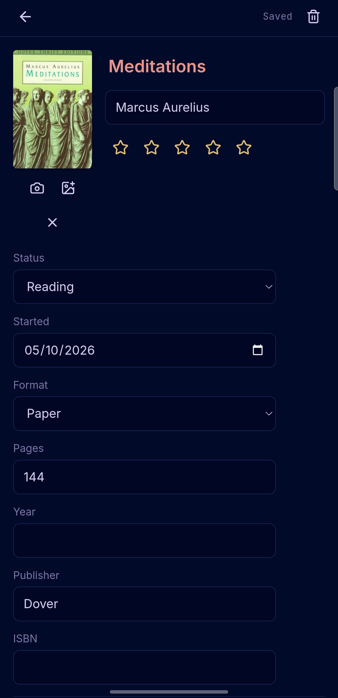
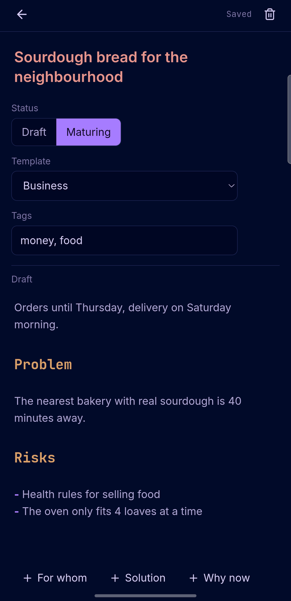
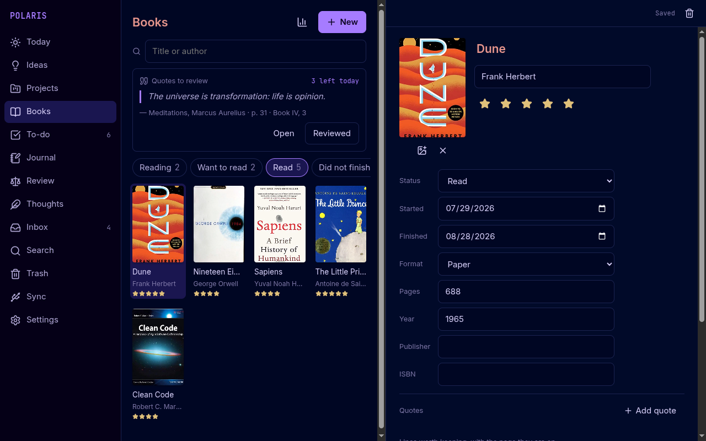
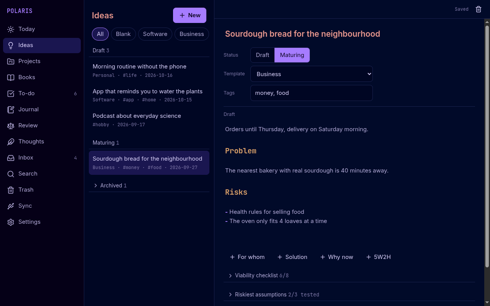
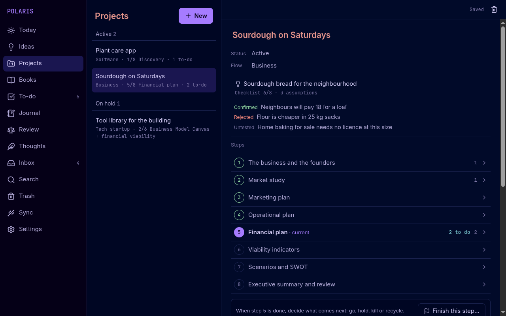
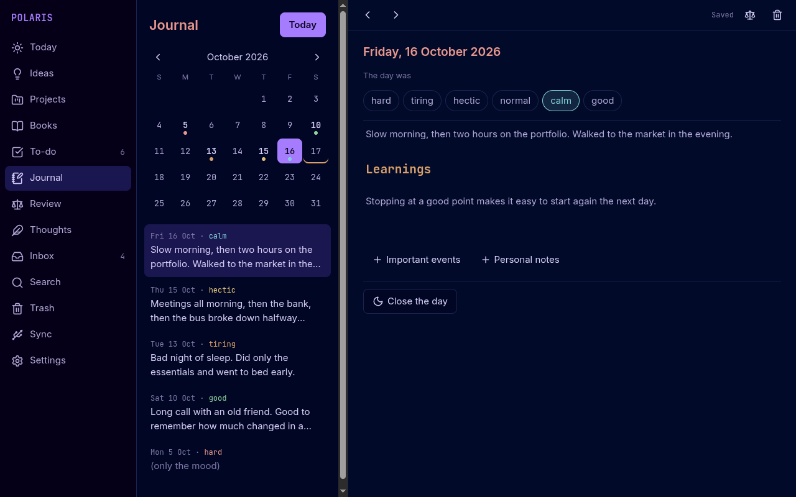

<p align="center"></p>

<h1 align="center">Polaris</h1>

<p align="center"><a href="README.pt-BR.md">🇧🇷 Leia em português</a></p>

<p align="center">
A personal notebook for to-dos, ideas, projects, books, a journal and an evening review.<br>
One app for <b>Linux</b> and <b>Android</b>, 100% offline, with your data kept as plain Markdown files.
</p>

<p align="center">

</p>

<p align="center">




</p>

## Why

- **Offline.** No account, no cloud, no tracking. The Android app does not even ask for the
  Internet permission.
- **Your files.** Everything is a Markdown file with a small YAML header in a folder you choose.
  Open it in any editor, back it up by copying the folder, keep it in git if you like.
- **Same app everywhere.** The same React interface runs in Electron on Linux and in Capacitor on
  Android, with a sidebar layout on wide screens and a bottom bar on phones.
- **Sync over a USB cable.** The PC app copies changes to and from the phone over `adb`, file by
  file, and shows conflicts side by side so you pick what to keep.
- **English and Brazilian Portuguese**, following the device language by default.

## Features

| Area | What it does |
| --- | --- |
| **Today** | Quick capture field, today's and overdue tasks, "This Evening", thought of the day, quotes to review, an old idea resurfacing, the day's journal card. |
| **To-do** | Things-style lists (Today, Upcoming, Anytime, Someday, Logbook) and your own lists; one-line quick add (`pay rent every month on the 5th #home !1`), recurrence, subtasks, priorities and reminders (Android notifications, Linux tray). |
| **Ideas** | Drafts with templates and optional sections, tags, a 5W2H block, a viability checklist with a score, the riskiest assumptions with how to test them, and an archive that keeps the reason. |
| **Projects** | Turn an idea into a project that follows a flow: **Business** (Sebrae's business plan guide), **Tech startup** or **Software**. Each step has guidance, notes, to-dos and a gate: go, hold, kill or recycle. |
| **Books** | A shelf with covers, reading status tabs, quotes by page with your comments, a daily quote review and reading stats. |
| **Journal** | One entry per day with a calendar, mood words and optional sections; "Close the day" in three questions. |
| **Review** | A Stoic evening review: eight questions, the four virtues and a thought of the day. |
| **Thoughts** | A built-in library of 64 quotes checked in public-domain translations, plus your own. |
| **Also** | Global search, trash with undo, zip backup and restore, a floating capture window (`polaris --capture`) for a desktop shortcut, and an Android "Capture" shortcut. |

<p align="center">


</p>
<p align="center">


</p>

## Your data

```
Polaris/
├── todo/        one file per task
├── inbox/       quick captures
├── ideas/
├── projects/    <project>/project.md + one folder per step
├── books/       <book>/book.md, cover.jpg, quotes/
├── journal/     2026-10-17.md
├── review/      2026-10-17.md
├── thoughts/
├── .trash/
└── .polaris/    settings, lists and sync state
```

A task looks like this:

```markdown
---
type: todo
created: 2026-10-14T21:10
status: open
when: 2026-10-17
time: "19:30"
repeat: FREQ=DAILY
list: study
---
# Practice Spanish for 20 minutes

- [x] Flashcards
- [ ] One podcast episode
```

Unknown header keys are kept as they are, so you can add your own.

## Install and build

**Downloads:** the [latest release](https://github.com/Leonardo-Sponton/polaris/releases/latest) has
the Android APK (Android 8.0 or newer) and a Linux AppImage and tar.gz.

To build it from source you need Node.js 22 or newer.

```sh
git clone https://github.com/Leonardo-Sponton/polaris.git
cd polaris
npm install
npm test            # unit tests (Vitest)
npm run electron    # run the desktop app
```

**Linux package**

```sh
npm run dist                          # release/: AppImage and tar.gz
cd packaging/arch && makepkg -si      # Arch Linux package
```

**Android** (Android 8.0 or newer; needs the Android SDK and JDK 21)

```sh
npm run android                       # build the web part and copy it into android/
cd android && ./gradlew assembleDebug
adb install app/build/outputs/apk/debug/app-debug.apk
```

On first run the Android app asks for "All files access", so it can read the files the PC copies
over the cable into `Documents/Polaris`.

**USB sync:** turn on USB debugging on the phone, connect it, then open *Sync* in the PC app.
`adb` is found in `PATH` or in `~/Android/Sdk/platform-tools`.

## Sample data

To see every screen filled in (the screenshots above were made this way):

```sh
node tools/sample-data.mjs add ~/PolarisDemo             # English
node tools/sample-data.mjs add ~/PolarisDemo --lang pt   # Portuguese
node tools/sample-data.mjs remove ~/PolarisDemo          # removes only the sample files
```

Book covers are downloaded from [Open Library](https://openlibrary.org/) when there is a
connection; the app itself never goes online.

## Stack

TypeScript, React and Vite · CodeMirror 6 editor with live Markdown preview · Electron (Linux) ·
Capacitor with a small Java plugin for file access (Android) · Vitest.

## License

[MIT](LICENSE) © Leonardo Sponton. Book covers in the screenshots belong to their publishers and
come from Open Library.
