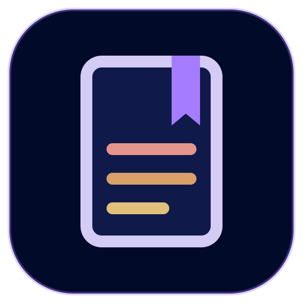
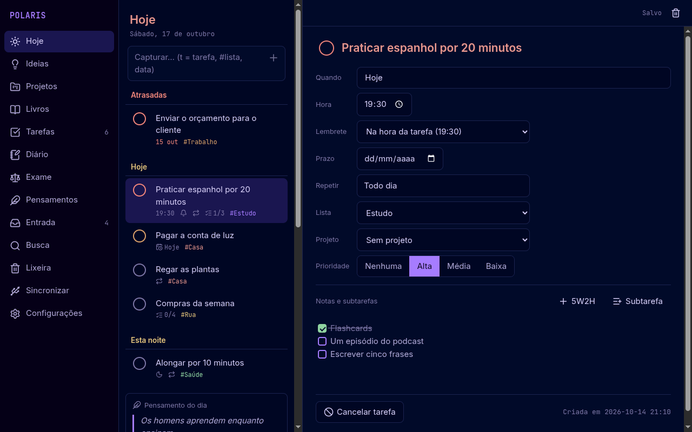
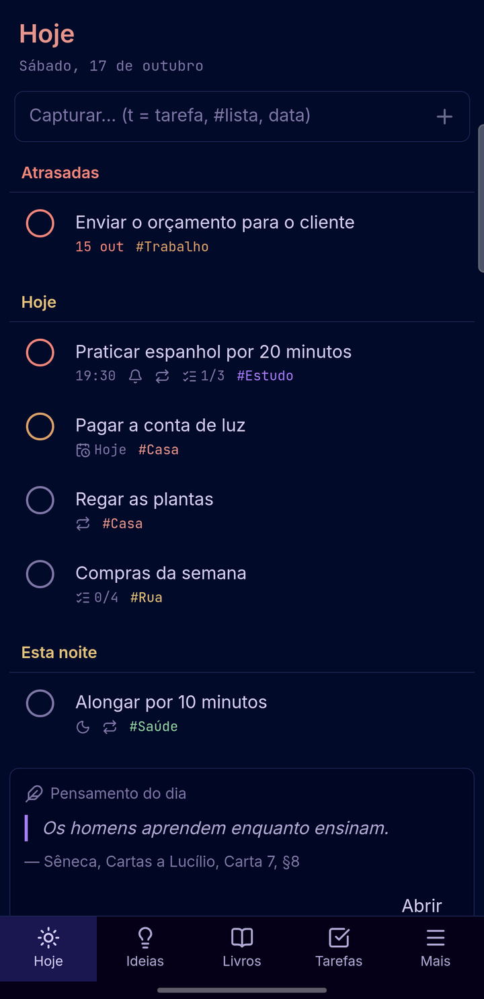
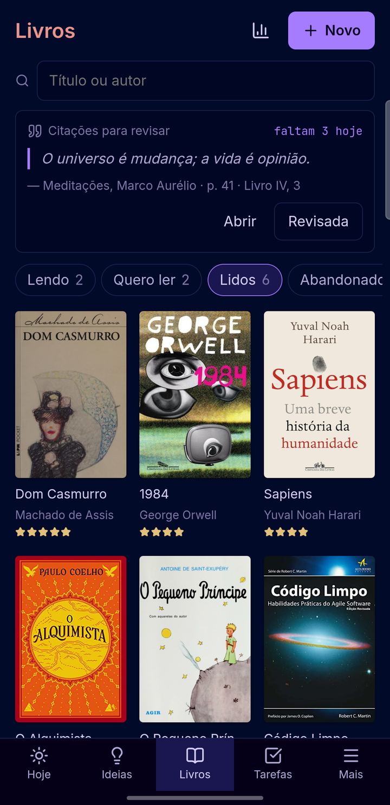
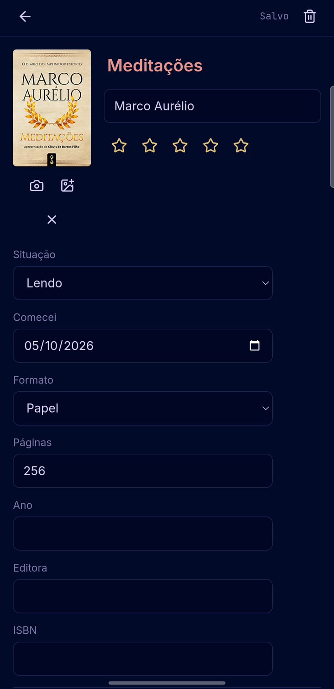
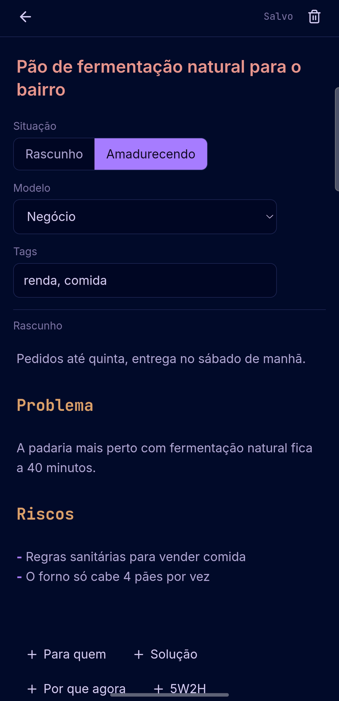
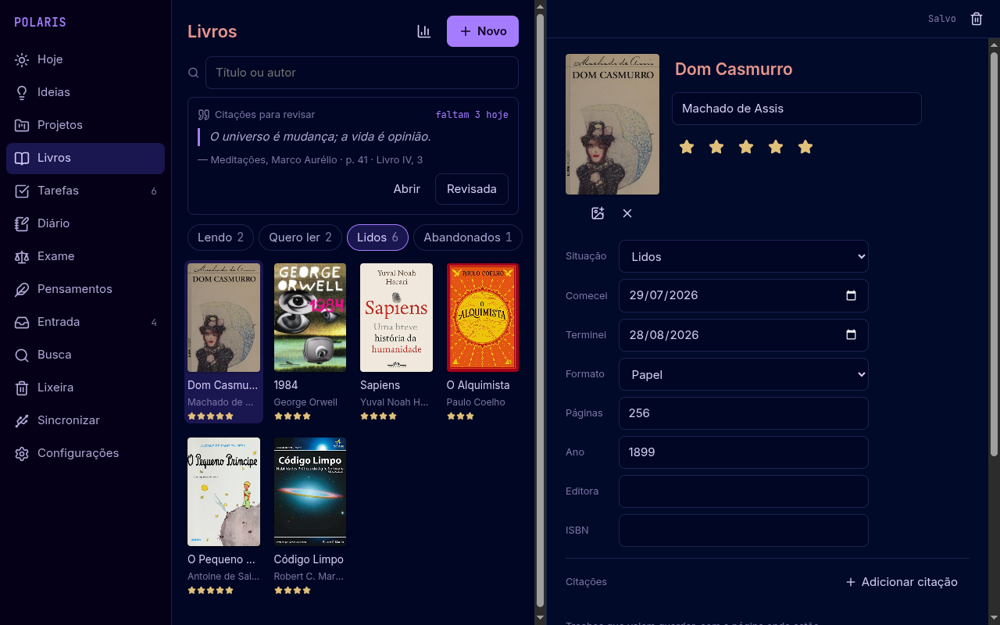
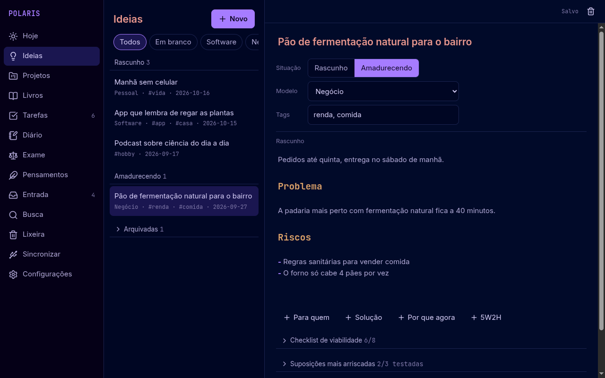
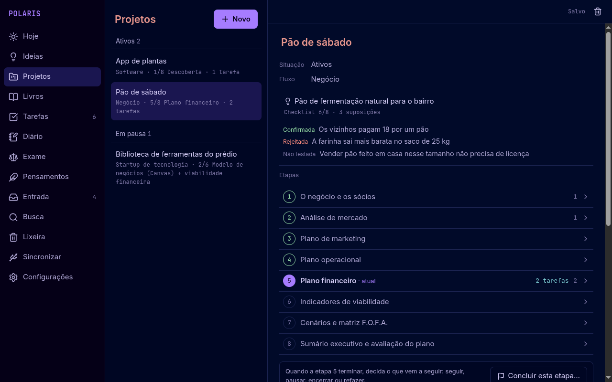
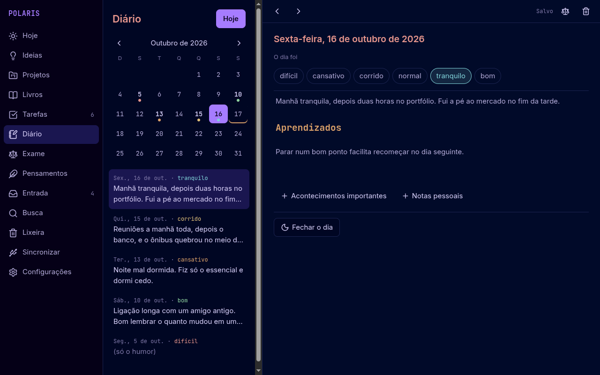

<p align="center"></p>

<h1 align="center">Polaris</h1>

<p align="center"><a href="README.md">🇺🇸 Read in English</a></p>

<p align="center">
Um caderno pessoal para tarefas, ideias, projetos, livros, diário e exame da noite.<br>
Um só app para <b>Linux</b> e <b>Android</b>, 100% offline, com os dados guardados em arquivos Markdown comuns.
</p>

<p align="center">

</p>

<p align="center">




</p>

## Por quê

- **Offline.** Sem conta, sem nuvem, sem rastreamento. O app Android nem pede a permissão de
  Internet.
- **Os arquivos são seus.** Tudo é um arquivo Markdown com um pequeno cabeçalho YAML numa pasta
  que você escolhe. Abra em qualquer editor, faça backup copiando a pasta, guarde no git se quiser.
- **O mesmo app em todo lugar.** A mesma interface React roda no Electron (Linux) e no Capacitor
  (Android), com barra lateral em telas largas e barra inferior no celular.
- **Sincronização pelo cabo USB.** O app do PC copia as mudanças para o celular e de volta via
  `adb`, arquivo por arquivo, e mostra os conflitos lado a lado para você escolher o que fica.
- **Português do Brasil e inglês**, seguindo o idioma do aparelho por padrão.

## Recursos

| Área | O que faz |
| --- | --- |
| **Hoje** | Campo de captura rápida, tarefas de hoje e atrasadas, "Esta noite", pensamento do dia, citações para revisar, uma ideia antiga que volta à tona e o cartão do diário. |
| **Tarefas** | Listas no estilo Things (Hoje, Próximas, A qualquer hora, Algum dia, Concluídas) e listas próprias; adição em uma linha (`pagar aluguel todo dia 5 #casa !1`), repetição, subtarefas, prioridade e lembretes (notificações no Android, bandeja no Linux). |
| **Ideias** | Rascunhos com modelos e seções opcionais, tags, bloco 5W2H, checklist de viabilidade com nota, suposições mais arriscadas com como testar, e arquivo que guarda o motivo. |
| **Projetos** | Transforme uma ideia num projeto que segue um fluxo: **Negócio** (guia de plano de negócio do Sebrae), **Startup de tecnologia** ou **Software**. Cada etapa tem orientação, notas, tarefas e uma decisão: seguir, pausar, encerrar ou refazer. |
| **Livros** | Estante com capas, abas por situação de leitura, citações por página com seus comentários, revisão diária de citações e estatísticas de leitura. |
| **Diário** | Uma entrada por dia com calendário, palavras de humor e seções opcionais; "Fechar o dia" em três perguntas. |
| **Exame** | Exame da noite estoico: oito perguntas, as quatro virtudes e um pensamento do dia. |
| **Pensamentos** | Biblioteca de 64 citações conferidas em traduções de domínio público, mais as suas. |
| **E mais** | Busca geral, lixeira com desfazer, backup e restauração em zip, janela flutuante de captura (`polaris --capture`) para um atalho do desktop e atalho "Capturar" no Android. |

<p align="center">


</p>
<p align="center">


</p>

## Seus dados

```
Polaris/
├── todo/        um arquivo por tarefa
├── inbox/       capturas rápidas
├── ideas/
├── projects/    <projeto>/project.md + uma pasta por etapa
├── books/       <livro>/book.md, cover.jpg, quotes/
├── journal/     2026-10-17.md
├── review/      2026-10-17.md
├── thoughts/
├── .trash/
└── .polaris/    configurações, listas e estado da sincronização
```

Uma tarefa fica assim:

```markdown
---
type: todo
created: 2026-10-14T21:10
status: open
when: 2026-10-17
time: "19:30"
repeat: FREQ=DAILY
list: study
---
# Praticar espanhol por 20 minutos

- [x] Flashcards
- [ ] Um episódio do podcast
```

Chaves desconhecidas no cabeçalho são mantidas como estão, então você pode acrescentar as suas.

## Instalar e compilar

**Downloads:** a [versão mais recente](https://github.com/Leonardo-Sponton/polaris/releases/latest) traz
o APK para Android (Android 8.0 ou mais novo) e um AppImage e um tar.gz para Linux.

Para compilar a partir do código é preciso o Node.js 22 ou mais novo.

```sh
git clone https://github.com/Leonardo-Sponton/polaris.git
cd polaris
npm install
npm test            # testes (Vitest)
npm run electron    # roda o app do desktop
```

**Pacote para Linux**

```sh
npm run dist                          # release/: AppImage e tar.gz
cd packaging/arch && makepkg -si      # pacote do Arch Linux
```

**Android** (Android 8.0 ou mais novo; precisa do Android SDK e do JDK 21)

```sh
npm run android                       # compila a parte web e copia para android/
cd android && ./gradlew assembleDebug
adb install app/build/outputs/apk/debug/app-debug.apk
```

Na primeira vez o app Android pede "Acesso a todos os arquivos", para conseguir ler os arquivos
que o PC copia pelo cabo para `Documents/Polaris`.

**Sincronização USB:** ative a depuração USB no celular, conecte o cabo e abra *Sincronizar* no
app do PC. O `adb` é procurado no `PATH` ou em `~/Android/Sdk/platform-tools`.

## Dados de exemplo

Para ver todas as telas preenchidas (as capturas acima foram feitas assim):

```sh
node tools/sample-data.mjs add ~/PolarisDemo --lang pt   # em português
node tools/sample-data.mjs add ~/PolarisDemo             # em inglês
node tools/sample-data.mjs remove ~/PolarisDemo          # remove só os arquivos de exemplo
```

As capas dos livros são baixadas do [Open Library](https://openlibrary.org/) quando há conexão;
o app em si nunca acessa a internet.

## Tecnologias

TypeScript, React e Vite · editor CodeMirror 6 com prévia do Markdown ao vivo · Electron (Linux) ·
Capacitor com um pequeno plugin Java para acesso aos arquivos (Android) · Vitest.

## Licença

[MIT](LICENSE) © Leonardo Sponton. As capas de livros nas capturas pertencem às suas editoras e
vêm do Open Library.
